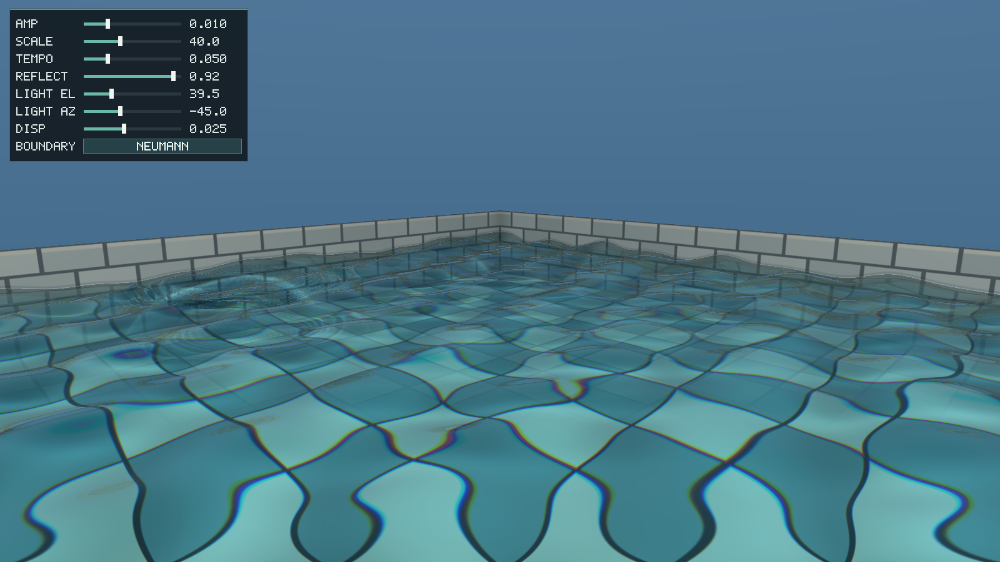
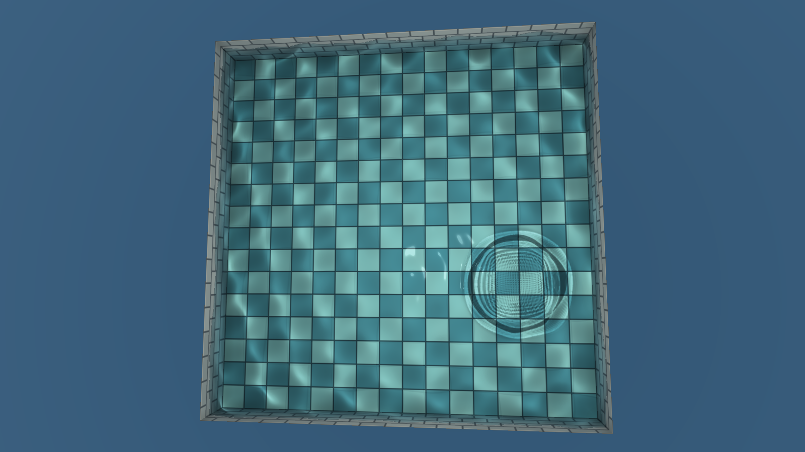
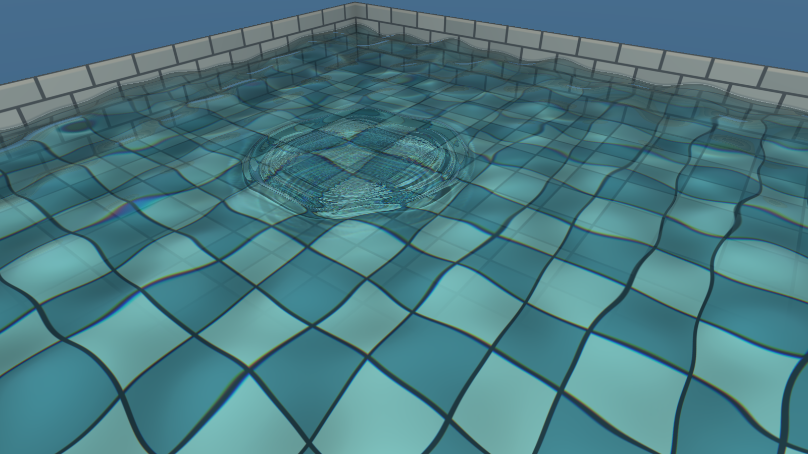
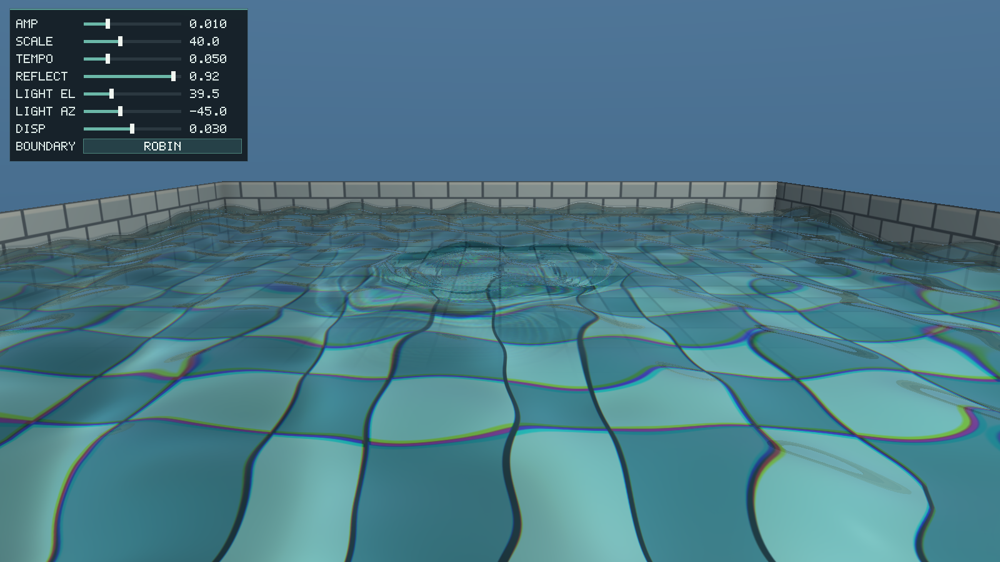

# Water Caustics Simulator

Real-time C++17 / OpenGL 3.3 shallow-water wave and caustics simulator with physically-based boundary hydrodynamics, 5-face floor-and-wall caustics, analytical pool-rim shadows, dynamic waterline shading, and camera-ray underwater refraction.



## Gallery

| Top-Down Pool & Wall Caustics | Oblique Refraction & Ripples | Grazing View & Chromatic Dispersion |
| :---: | :---: | :---: |
|  |  |  |

## Key Features

- **Boundary Hydrodynamics (`src/sim/wave_sim.{h,cpp}`)**
  - Pure C++17 velocity-damped 2D wave solver (`dt = 0.5`, Courant `r = 0.50` clamped `<= 0.65`, O(1) 3-buffer swap rotation) using canonical row-major `(y * width + x)` storage and a 60 Hz fixed-timestep accumulator.
  - Four selectable boundary conditions:
    - `ReflectiveNeumann` (default): 2nd-order ghost-cell mirroring (`∂h/∂n = 0`) on all four edges and corners for in-phase wall run-up and volume conservation.
    - `PartialAbsorbRobin`: discrete impedance boundary with tunable `wallReflection` (`0..1`) modeling gutter/wall dissipation.
    - `AbsorbingOpen`: 1st-order Mur absorbing boundary condition paired with a 12-cell cosine-tapered sponge layer.
    - `FixedDirichlet`: legacy pinned zero-height border for comparison.
  - Additive C1-smooth raised-cosine splash drops mirror-folded across reflective walls, plus zero-mean multi-directional traveling wind waves.

- **Optical Boundary Interactions (`src/render/pool_optics.h`, `caustics_pass.*`, `pool_renderer.*`)**
  - Exact ray–pool-box intersection projects refracted sunlight onto a **5-face unfolded cross caustic atlas** (`GL_RGBA16F`) covering the pool floor and all four underwater walls seamlessly across floor–wall creases.
  - Single-window 16-tap analytical Catmull-Rom height and gradient evaluation (`sampleHeightAndGrad`), fragment-derivative (`dFdx`/`dFdy`) area-ratio caustic flux, Fresnel transmittance `(1 - F)`, total internal reflection discard, optional 3-pass RGB chromatic dispersion, and analytical pool-rim sun occlusion (`rimVisibility`).
  - Dynamic wet/dry wall shading driven by the live wave height along each wall, with wet stone darkening, Beer-Lambert depth absorption, and a subtle waterline meniscus band.

- **Water Surface & Visual Continuity (`src/render/water_renderer.*`, `shaders/water_shaders.h`)**
  - Analytical Neumann-mirrored Catmull-Rom normals evaluated per-vertex and per-fragment, plus an inward-tilting capillary meniscus normal curve along the four walls and a watertight perimeter seam.
  - Offscreen `SceneTargets` (`GL_RGBA16F` + `GL_DEPTH_COMPONENT24`) camera-ray underwater refraction with linearized depth validation to prevent dry walls from bleeding into underwater refraction, Beer-Lambert turquoise depth absorption, Schlick Fresnel reflections against both above-water masonry walls and sky, and GGX sun specular highlights.

- **Interactive Engine & HUD (`src/ui/*`, `src/app.*`)**
  - Live framebuffer resize & HiDPI scaling, 1-draw-call batched HUD overlay (`OverlayUI`), interactive orbit/pan/zoom camera with presets `1`–`4`, hemisphere light dragging, and deterministic CLI `--dump` frame capture.

## Architecture

```text
├── main.cpp                         # Thin entrypoint delegating to App
├── src/
│   ├── app.{h,cpp}                  # GLFW lifecycle, fixed-dt loop, SceneTargets FBO, CLI, BMP dump
│   ├── sim/
│   │   └── wave_sim.{h,cpp}         # Pure C++17 wave solver & boundary modes (zero GL/GLFW deps)
│   ├── render/
│   │   ├── pool_coords.h            # Single source of truth for grid <-> world <-> UV mapping
│   │   ├── pool_optics.h            # Shared CPU/GLSL ray-box hit, 5-face atlas, rim occlusion
│   │   ├── scene_state.h            # LightConfig, RenderSettings, SceneTargets, CameraState
│   │   ├── shader_program.{h,cpp}   # GLSL compiler/linker & uniform location cache
│   │   ├── caustics_pass.{h,cpp}    # Height texture upload & 5-face caustic atlas pass
│   │   ├── pool_renderer.{h,cpp}    # Inward-wound pool floor + 4-wall renderer
│   │   ├── water_renderer.{h,cpp}   # Water mesh & refractive/reflective surface pass
│   │   ├── skybox_renderer.{h,cpp}  # Procedural sky dome gradient
│   │   └── shaders/                 # Modular GLSL shader headers
│   └── ui/
│       ├── camera.{h,cpp}           # Spherical orbit/pan/zoom camera, presets, ray unprojection
│       └── overlay_ui.{h,cpp}       # 1-draw-call batched sliders, boundary button, 5x7 font
├── include/glad/                    # OpenGL 3.3 core loader
└── verify/                          # Stability, boundary, optics, and BMP visual regression tests
```

## Interactive Controls & HUD

| Input | Action |
| --- | --- |
| Left-click on water | Add smooth Gaussian water drop |
| Right-drag | Orbit camera |
| Middle-drag or `Shift` + Right-drag | Pan camera |
| Mouse wheel | Zoom camera |
| `1` / `2` / `3` / `4` | Camera presets (Top-down, Classic oblique, Low corner wall view, Grazing side view) |
| `L` + Left-drag | Move light across hemisphere |
| `Space` | Pause / resume simulation |
| `R` | Reset water surface |
| `B` | Cycle boundary mode (`NEUMANN` / `ROBIN` / `ABSORB` / `DIRICHLET`) |
| `H` | Toggle HUD overlay |
| `Esc` | Quit |

The top-left HUD provides live sliders for `AMP`, `SCALE`, `TEMPO`, `REFLECT` (`wallReflection`), `LIGHT EL`, `LIGHT AZ`, and `DISP` (`dispersion`), plus a clickable `BOUNDARY` mode button.

## CLI Reference

```text
caustics [options]
  --dump <path.bmp> [frames]                        Capture 24-bit BMP after N frames (default 180) and exit
  --wind <amp> <wavelength> <tempo>                 Set initial wind parameters
  --drop <gx> <gy> <amp> <frame>                    Inject a drop at grid cell (gx, gy) on the given frame
  --camera <ex> <ey> <ez> <tx> <ty> <tz>            Set camera eye and target positions
  --preset <1|2|3|4>                                Select camera preset
  --light <x> <y> <z>                               Set light position
  --boundary <reflective|robin|absorb|dirichlet>    Select wave boundary condition
  --dispersion <val>                                Set chromatic dispersion strength
  --no-ui                                           Hide HUD overlay
```

## Build & Run

Requirements: C++17 compiler, CMake 3.15+, OpenGL 3.3+, GLM, and GLFW 3.4+.

Initialize the GLM submodule first:

```bash
git submodule update --init external/glm
```

### Windows (MinGW-w64)

Download the [GLFW 3.4 64-bit Windows binaries](https://github.com/glfw/glfw/releases/download/3.4/glfw-3.4.bin.WIN64.zip) and copy `lib-mingw-w64` into `external/glfw-3.4.bin.WIN64/lib-mingw-w64`. Then build with `gcc`/`g++` on `PATH`:

```powershell
cmake -G "MinGW Makefiles" -DCMAKE_C_COMPILER=gcc -DCMAKE_CXX_COMPILER=g++ -S . -B build
cmake --build build
.\build\caustics.exe
```

### Linux / macOS / vcpkg

`CMakeLists.txt` automatically falls back to `find_package(glfw3)` and system GLFW/GLM installations when the bundled Windows MinGW libraries are not present:

```bash
# Ubuntu/Debian: sudo apt install libglfw3-dev libglm-dev
# macOS Homebrew: brew install glfw glm
cmake -S . -B build
cmake --build build
./build/caustics
```

## Verification Suite

Run all C++ verification tests (`wave_stability`, `boundary_tests`, and `optics_tests`):

```powershell
powershell -ExecutionPolicy Bypass -File verify/check.ps1
```

Visual regression checks on captured 24-bit BMP dumps:

```powershell
# Submerged wall caustics, dry-wall cleanliness, and water-wall seam check
.\build\caustics.exe --preset 3 --light 120 -120 140 --no-ui --dump .audit/walls.bmp 180
python verify/wall_caustics_check.py --preset 3 .audit/walls.bmp

# Floor caustic ring-band check (classic oblique or top-down preset)
.\build\caustics.exe --preset 2 --no-ui --dump .audit/classic.bmp 180
python verify/ring_band.py .audit/classic.bmp
```

See [.audit/caustic-contract.md](.audit/caustic-contract.md) for the full architectural and optical specification.
